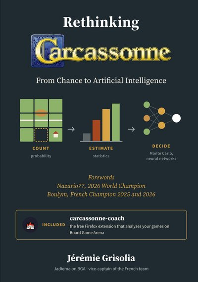

English · [Français](README.fr.md)

# Carcassonne Coach

An artificial-intelligence coach for Carcassonne (base game, 2 players) on Board Game Arena (BGA). The Firefox extension reads a finished game or a replay (analysis is disabled during a game in progress, in line with Board Game Arena’s rules), searches for the best moves with a Monte Carlo tree search (MCTS) guided by a neural network, and shows them on the board. All computation runs in the browser; no data is sent anywhere.

> Independent project, not affiliated with Hans im Glück or Board Game Arena. Carcassonne is a registered trademark of Hans im Glück Verlags-GmbH. The coach reproduces no image of the game: it reads the Board Game Arena page in your browser. Only the book covers, included in the extension, carry the Carcassonne logo, used with the permission of Hans im Glück.

This repository accompanies the book *Rethinking Carcassonne – From Chance to Artificial Intelligence* (Éditions Jadiema).

## The book



**Rethinking Carcassonne – From Chance to Artificial Intelligence** (Éditions Jadiema)

Forewords by Nazario77, 2026 World Champion, and Boulym, French Champion 2025 and 2026

> **How do you play Carcassonne well? Chance is not fate. It can be counted.**
>
> With more than 12 million copies sold, Carcassonne is seen as a game of luck: you draw a tile, you place it, and chance does the rest. This book shows the opposite.

The coach is the companion of the book: every calculation in the extension is explained step by step, and the **📖 ch. N** badges in the panel point to the matching chapter.

Coming soon on Amazon

## Contents

- [The book](#the-book)
- [Installation](#installation)
- [Using it on Board Game Arena](#using-it-on-board-game-arena)
- [How it works](#how-it-works)
- [Local server (optional)](#local-server-optional)
- [Building the training data](#building-the-training-data)
- [Training and evaluating the network](#training-and-evaluating-the-network)
- [Analysis scripts](#analysis-scripts)
- [Building the extension package](#building-the-extension-package)
- [File layout](#file-layout)
- [History and current state](#history-and-current-state)
- [Known limitations](#known-limitations)
- [License](#license)

## Installation

1. In Firefox (version 140 or later), open the [latest release](https://github.com/jadiema/carcassonne-coach/releases/latest).
2. Click `carcassonne-coach.xpi`, then **Add**.

That’s all: nothing else to install. The extension is signed by Mozilla, it stays in place after Firefox restarts, and later versions install automatically.

## Using it on Board Game Arena

1. Open a finished Carcassonne game or a replay on BGA.
2. Click the 🏰 button added by the extension, choose your player and the analysis time.
3. Start the analysis: the best moves appear on the board. The suggested tile is drawn in its correct orientation, with the meeple in place.

The **Probabilities** tab follows the calculations of chapters 1 to 3 of the book: what is left in the bag, tile families (road ends, straights, corner cities, true curves, city caps, bends) with the chance on the next draw and over your next draws, entropy in bits, and the holes on the board around your structures, including the merge with an opponent’s city. It follows the replay position shown on screen, forwards and backwards.

The interface is available in French and English: click the flag in the panel to switch language (the choice is remembered).

## How it works

```
 Firefox (boardgamearena.com)
┌───────────────────────────────┐         ┌──────────────────────────────────────┐
│ content-script.js             │         │ engine_worker.js (Pyodide + NumPy)   │
│  · reads board, tile in       │ ──────▶ │   └─ browser_coach.py                │
│    hand, free squares, bag    │         │        · carcassonne_engine.py       │
│  · shows the recommended      │ ◀────── │          rules, scoring, MCTS        │
│    moves                      │         │        · network in NumPy            │
└───────────────────────────────┘         │          (torch_free.py)             │
                                          └──────────────────────────────────────┘
                    (if running: server.py on port 5555, about twice as fast)
```

- **The extension** reads the position on BGA: board, tile in hand, free squares, remaining tiles, scores and meeples.
- **The Python engine** (`carcassonne_engine.py`) runs in the browser thanks to Pyodide 0.26.4. It generates the legal moves, then runs the MCTS for the chosen time. Moves are ranked by number of visits, and the price of a tied-up meeple is taken into account.
- **The network** (`carcassonne_model.pt`, read without PyTorch by `torch_free.py`) provides:
  - a **policy**: a probability for each (square, rotation), which steers the exploration;
  - a **value**: the chance of winning, which judges positions in the search.
- **The opponent’s reply** (`expectimax_rerank`) breaks ties between the best moves by also looking at the opponent’s next move (two-move Expectimax), with a chance of closing cities computed from the bag and city merges.

## Local server (optional)

The extension needs nothing else. To go about twice as fast, you can start the repository’s Python server: the extension then uses it automatically.

```
pip install -r requirements.txt
python server.py
```

On Windows, `start_server.bat` does the same. The server listens on `http://127.0.0.1:5555`.

## Building the training data

1. On BGA, open a finished game (preferably between strong players) and click the extension’s JSON button.
2. Put the files in the `parties/` folder.
3. Check that each game replays exactly:

```
python replay_bga.py parties
```

Each game must show `✅ … rejouée à l’identique`: the replay redoes every move and compares the final scores with BGA’s. Games that fail are left out of training.

**Games with “1st edition” tiles.** In replays, BGA shows the edition chosen by the players; the extension does not recognise these images. `replay_bga.py` then identifies the tiles by deduction and learns the image → type mapping in `ed1_art_table.json`. Running the check a second time often replays the games that had failed.

> The content of `parties/` is not versioned: these are other players’ games, with their usernames. Only `carcassonne_model.validation.json` (the list of validation games) is tracked.

## Training and evaluating the network

Training requires PyTorch; a graphics card (CUDA) speeds it up considerably.

### Self-play

```
python selfplay.py --value
```

The engine plays against itself with the current network; the games are stored in `parties/`.

### Training

```
python neural_evaluator.py train parties 30 --selfplay-keep=0.04
```

- at most 30 epochs, automatic stop after 4 epochs without progress on validation;
- the validation set is fixed (`carcassonne_model.validation.json`); `--new-split` draws a new one;
- each board is presented in its 4 rotations;
- `--selfplay-keep` sets the share of self-play positions kept;
- games are read in parallel.

At the start of training, check the « Contrôle des rotations » line: no rotation should remain « sans équivalent ».

### Evaluating

```
python arena.py --a carcassonne_model_v33.pt --b carcassonne_model_v28.pt
```

Plays two configurations against each other and gives the Elo difference. Options: `--sims-a/b` (number of simulations), `--value-a/b` (value head), `--reply-a/b` (opponent’s reply).

```
python evaluate_model.py parties
```

Replays the validation games and measures, for each position, whether the move actually played by the strong player is in the top 1 / top 3 of each method. Results of network v33 (989 positions from the 15 validation games):

| Method | Top 1 | Top 3 |
|---|---|---|
| Random among legal moves | 6.4% | 19.0% |
| Engine heuristic | 31.2% | 48.6% |
| Network, value head | 20.3% | 37.8% |
| Network, policy | 36.4% | 62.5% |

The validation list (`carcassonne_model.validation.json`) contains only table numbers; these games must never be used for training.

`bench_mcts.py` measures whether the MCTS search finds the strong players’ move (top 1 / top 3, full move).

## Analysis scripts

| Script | Purpose | Command |
|---|---|---|
| `replay_bga.py` | Replays the games and checks the final scores; learns the 1st-edition images | `python replay_bga.py parties` |
| `evaluate_model.py` | Compares network, heuristic and random play on the validation games | `python evaluate_model.py parties` |
| `prix_meeple.py` | Follows each meeple from placement to return: yield (points per turn tied up) by phase, structure and meeple supply | `python prix_meeple.py parties` |
| `prix_tuile_blocage.py` | Price of the blocking tile | `python prix_tuile_blocage.py parties` |
| `stats_tuiles.py` | Tile statistics | `python stats_tuiles.py parties` |
| `virage_premier_tour.py` | First turn with a simple curve: how long a meeple placed on the road stays tied up, or how often the curve is played without a meeple (the « coup de Nazario ») | `python virage_premier_tour.py parties` |
| `bayes_paysans.py` | Looks for two player styles (aggressive / cautious) in the fields with a mixture of binomial distributions (EM algorithm) | `python bayes_paysans.py parties` |
| `diag_rotation.py` | Diagnoses the rotation convention of the data augmentation | `python diag_rotation.py parties` |
| `check_spots.py` | Checks the table of BGA meeple spots | `python check_spots.py parties` |
| `calibrate_spots.py` | Searches for the assignment of ambiguous farmers when only the final scoring differs from BGA | `python calibrate_spots.py parties` |

Output files (CSV, PNG) are not versioned.

## Building the extension package

```
python build_xpi.py
```

Produces `carcassonne-coach-<version>.xpi`, to be signed by Mozilla. **Do not use `web-ext build`**, which leaves out `.zip` files (including `pyodide/python_stdlib.zip`, which is essential).

Before any release, `python verifier_pseudos.py` checks that no player username appears in the tracked files or in the history. It reads the usernames from `parties/` when it runs and contains none itself. People who have agreed to be named (author, foreword writers) are listed in the versioned allow-list `pseudos_autorises.txt`.

Safeguard before each push: `python verifier_pseudos.py --installer-hook` installs a local git `pre-push` hook (not versioned, to be redone after each clone) that blocks the push if a username is found in what is being pushed (files, file names, commit and tag messages), or if `parties/` is missing.

Tests: `node --test tests/probabilites.test.js` (calculations of the Probabilities tab) and `python tests/test_holes.py` (holes on the board).

## File layout

```
carcassonne-coach/
├── manifest.json               Firefox extension (Manifest V3)
├── content-script.js           Reads the game on BGA, shows the moves
├── content-style.css
├── background.js
├── engine_worker.js            Engine in the browser (Pyodide)
├── probabilites.js            Calculations of the Probabilities tab
├── popup.html, popup.js
├── images/                     Extension icons
├── pyodide/                    Pyodide 0.26.4 and NumPy
├── browser_coach.py            Entry point of the coach in the browser
├── torch_free.py               Reads the network without PyTorch
├── verify_torch_free.py        Checks that torch_free.py gives the same result as PyTorch
├── carcassonne_engine.py       Rules, scoring, move generation, MCTS
├── neural_evaluator.py         Board encoding, network, training
├── server.py, start_server.bat Optional local server (port 5555)
├── selfplay.py, arena.py, bench_mcts.py   Self-play, matches, MCTS bench
├── replay_bga.py, evaluate_model.py       Replay and evaluation
├── prix_meeple.py, prix_tuile_blocage.py, stats_tuiles.py,
│   virage_premier_tour.py, bayes_paysans.py                Analyses
├── diag_rotation.py, check_spots.py, calibrate_spots.py   Diagnostics
├── build_xpi.py                Builds the extension package
├── verifier_pseudos.py         Username check before release
├── pseudos_autorises.txt       Allowed usernames (author, foreword writers)
├── tests/                      Tests of the Probabilities tab and of the holes on the board
├── updates.json                Automatic updates of the extension
├── ed1_art_table.json          Learned table: 1st-edition images → tile types
├── carcassonne_model.pt        Current network (policy + value)
├── carcassonne_model.validation.json   The fixed validation games
├── parties/                    Exported games (not versioned)
├── NOTES-VERIFICATEURS-MOZILLA.txt   Notes and test procedure for Mozilla reviewers
├── CLAUDE.md                   Instructions for the development assistant (Claude Code)
├── requirements.txt
├── LICENSE
├── README.md                   Overview in English (shown by GitHub)
└── README.fr.md                Overview in French
```

## History and current state

- **3.1.0**: Probabilities tab (chapters 1 to 3 of the book: families, entropy, holes on the board), header synchronised with the replay.
- **3.0.4**: analysis strictly limited to finished games and replays, also enforced by the engine; network v33 with a value head, trained on 10,000 self-play games (**+69 Elo** against network v28 of 3.0.2, 200 games); opponent’s reply; tile drawn in the correct orientation.
- **3.0.2**: first signed version, all computation in the browser, French / English interface (withdrawn in favour of 3.0.4).
- **v32**: MCTS ranked by visits and price of the meeple; agreement with strong players goes from about 13% to 25% in top 1.
- **v28**: 4-rotation policy, rotation consistency check.

Arena measurements: doubling the computation only brings about +23 Elo (not significant); the limiting factor is the evaluation. A second self-play cycle (network v34) did no better than v33, which remains the reference network.

Data: 401 human games replayed exactly, including games with 1st-edition tiles, and several thousand self-play games.

## Known limitations

- **Opening**: with many tiles left, reasonable moves are close and their order partly depends on the randomness of the simulations.
- **Multi-move plans**: sharing, future junctions and blocks remain hard to see beyond the opponent’s reply.
- **Speed**: pure-Python engine, slower still in the browser; the local server is about twice as fast.
- **Variants**: only the 2-player base game is supported.

## License

Copyright © 2026 Jérémie (Jadiema) — Éditions Jadiema

This program is free software: you can redistribute it and/or modify it under the terms of the GNU General Public License version 3, as published by the Free Software Foundation. Any modified version you distribute must remain under the same license, with its source code.

This program is distributed in the hope that it will be useful, but WITHOUT ANY WARRANTY; without even the implied warranty of MERCHANTABILITY or FITNESS FOR A PARTICULAR PURPOSE. The full text of the license is in the `LICENSE` file.
